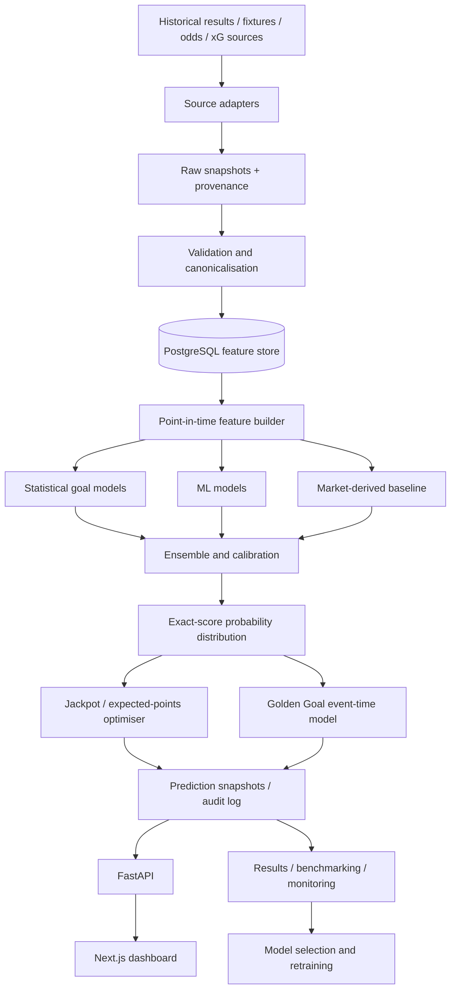

# Super 6 AI — System Design Document

> **Project:** Super 6 AI Prediction Engine  
> **Document:** `DESIGN.md`  
> **Version:** 1.0 — Initial technical design  
> **Status:** Proposed; not yet implemented  
> **Last updated:** 5 November 2026  
> **Primary audience:** Software engineers, data engineers, ML engineers, and project maintainers

---

## 1. Executive Summary

Super 6 AI is a football forecasting system designed to recommend exact-score predictions for the six fixtures in each Sky Sports Super 6 round, together with a Golden Goal minute. Rather than asking a large language model (LLM) to guess scores, it will construct **calibrated probability distributions** over possible match scores and select predictions for two different objectives:

1. **Jackpot mode:** maximise the estimated probability that all six exact scores are correct.
2. **Points mode:** maximise expected points under the competition's scoring rules.

The system will combine transparent statistical goal models, optional machine-learning models, and carefully timestamped market information. It will use chronological backtesting to determine which components improve predictions on unseen fixtures. A dashboard will present suggested scores, alternatives, confidence information, model explanations, historical performance, and the recommended Golden Goal minute.

The initial release is a **dedicated Super 6 decision-support tool**. The underlying football forecasting components will remain reusable for other leagues and competitions, but expansion is deliberately out of scope until the Super 6 workflow is proven.

**Key design principle:** complexity must earn its place. A sophisticated model is only adopted when it performs better on out-of-sample data than simpler, well-calibrated baselines.

---

## 2. Product Vision, Goals, and Non-Goals

### 2.1 Vision

Create an evidence-driven, automatically updated football prediction platform that makes the strongest possible recommendations from information available **before the entry deadline**, measures its performance honestly, and improves through reproducible experimentation.

### 2.2 Primary goals

- Produce one complete six-fixture prediction set per Super 6 round.
- Estimate a full probability distribution of exact scores for every fixture.
- Support separate jackpot and expected-points recommendation modes.
- Produce a Golden Goal estimate using a distinct, auditable model.
- Identify the applicable fixtures, kickoff times, and entry deadline reliably.
- Refresh predictions when relevant pre-match information changes.
- Maintain a time-stamped history of predictions, model versions, inputs, and actual outcomes.
- Backtest models without look-ahead bias or training/validation leakage.
- Benchmark against simple statistical, market-based, and fixed-score strategies.
- Expose understandable explanations and uncertainty rather than unsupported claims of certainty.

### 2.3 Secondary goals

- Provide individual-match forecasts for supported leagues.
- Quantify the incremental value of xG, player availability, odds, and other features.
- Compare models and track drift across seasons and competitions.
- Support a future authenticated, multi-user product if there is a legitimate use case.

### 2.4 Non-goals for v1

- Guaranteed correct scores, guaranteed winnings, or predictions marketed as certain.
- Placing bets, recommending staking amounts, or automatically entering paid wagers.
- Automatically submitting Super 6 entries or circumventing anti-bot measures.
- Building an LLM-only score predictor.
- Using live in-match information for a prediction that is supposed to be locked before kickoff.
- Developing a custom deep neural network before demonstrating a meaningful gain over simpler approaches.
- Making the whole platform dependent on any single unofficial or unstable scraped data source.

---

## 3. Competition Rules and Prediction Objectives

### 3.1 Rules used for the initial design

The reported Super 6 scoring convention is:

| Actual outcome relative to submitted prediction | Points |
|---|---:|
| Correct exact full-time score | 5 |
| Correct home/draw/away result but wrong score | 2 |
| Incorrect result | 0 |

An entry contains six predicted scores and a **Golden Goal** prediction, which is used as a tie-breaking mechanism in relevant competitions. Published explanations describe goal minutes as **1-indexed**: a goal at 05:00–05:59 is recorded as minute **6**. The official competition rules, fixture eligibility, deadlines, postponement handling, prize rules, and goal-recording conventions must be checked before each release and whenever the operator updates them.

**Important:** the values above are configuration defaults, not hard-coded business logic. The authoritative rules at the time of each round determine scoring. A correct exact score yields **5 total points**, not 5 + 2.

### 3.2 Jackpot objective

For fixture \(i\), let \(p_i(h,a)\) be the estimated probability of home goals \(h\) and away goals \(a\). If match scores are conditionally independent, the probability of an entire six-score selection \(S\) is:

\[
P(S) = \prod_{i=1}^{6} p_i(h_i,a_i).
\]

The jackpot-mode choice is:

\[
S_{\text{jackpot}}^* = \arg\max_S P(S).
\]

Under the independence assumption, selecting the most likely exact score in each match maximises the estimated joint chance. Cross-match dependence (shared weather, overlapping squad news, correlated team-strength uncertainty, etc.) can be investigated later with joint simulations; it should **not** be assumed away when presenting a precise six-match success probability.

### 3.3 Expected-points objective

For a proposed score \(s=(h,a)\), define:

- \(p_s = P(\text{exact score }s)\)
- \(p_R = P(\text{same home/draw/away result as }s)\)

Then:

\[
E[\text{points}\mid s]
= 5p_s + 2(p_R-p_s)
= \boxed{3p_s + 2p_R}.
\]

For additive scoring across fixtures:

\[
S_{\text{points}}^* = \arg\max_S \sum_{i=1}^{6} E[\text{points}_i\mid s_i].
\]

This objective can select a different score than jackpot mode because it values the aggregate probability of the correct win/draw/loss outcome.

### 3.4 Golden Goal objective

The Golden Goal subsystem predicts the recorded minute of the **first goal across the six eligible fixtures**, according to the currently applicable official definition. It must:

- Use actual fixture dates and kickoff times, including games starting at different times.
- Model first-goal event times, not simply pick the lowest scoreline minute.
- Convert event time into the game's official minute convention.
- Handle first- and second-half stoppage time, delays, reschedules, and a round without goals.
- Optimise for the stated tie-break rule (for example, expected absolute minute error if *closest minute* determines rank), not necessarily the single most probable minute.

A final goal minute recommendation must be backed by a probability distribution and labelled with its expected error or prediction interval. The fallback/no-goal convention must follow the rules for that particular round.

### 3.5 Rule configuration

Store a versioned competition-rules object with fields equivalent to:

```yaml
competition: sky_super_6
rules_version: "verified-date-or-operator-version"
fixtures_per_round: 6
points_exact_score: 5
points_correct_result_only: 2
points_incorrect: 0
golden_goal_enabled: true
golden_goal_minute_indexing: one_based
golden_goal_tiebreak: closest_minute
submission_policy: manual_only
```

Rules validation should block release of predictions when a changed or unknown competition setting could alter the optimiser.

---

## 4. Scope and User Experience

### 4.1 User journey

1. The system detects or imports the six fixtures for the upcoming round.
2. It validates opponents, competition, kickoffs, and deadline.
3. Data collectors refresh allowed pre-match information.
4. Feature pipelines create an **as-of-deadline** feature snapshot.
5. Statistical and ML models generate independent forecast distributions.
6. An ensemble combines and calibrates their outputs.
7. The optimiser selects scores for both modes and predicts Golden Goal.
8. The dashboard displays recommendations and important limitations.
9. The user manually submits an entry through the official Super 6 service.
10. After official results are settled, the platform calculates scores and records performance.

### 4.2 Dashboard sections

**Round overview** — six fixtures, kickoff times, submission deadline, round status, latest refresh, source health.

**Recommended entry** — six exact-score picks, Golden Goal minute, selected optimisation mode, and copy-friendly entry summary.

**Match detail** — top scoreline probabilities, home/draw/away probabilities, expected goals, recent evidence, uncertainty, and model disagreements.

**Comparison view** — jackpot-mode versus points-mode picks; highlights only where the choices differ.

**Performance** — current season and all-time backtested/live points, exact hits, baseline comparisons, calibration, and Golden Goal errors.

**Data and model health** — missing sources, stale features, last successful pipeline, active model version, and prediction-lock status.

### 4.3 Example presentation (illustrative only)

| Fixture | Jackpot pick | Points pick | Most likely score probability | Expected home/away goals |
|---|---|---|---:|---|
| Home A vs Away B | 2–1 | 2–1 | 13.8% | 1.74 / 1.10 |
| Home C vs Away D | 1–1 | 1–0 | 12.5% | 1.31 / 0.99 |

These are dummy values. The UI must never present an example as a genuine upcoming-round forecast.

---

## 5. Functional Requirements

| ID | Requirement | Priority |
|---|---|---|
| FR-01 | Import or manually configure the official six fixtures and deadline | P0 |
| FR-02 | Ingest historical full-time scores and relevant fixture metadata | P0 |
| FR-03 | Create point-in-time-safe pre-match features | P0 |
| FR-04 | Fit and serve a statistical exact-score model | P0 |
| FR-05 | Return a normalised or explicitly tail-accounted goal-score distribution | P0 |
| FR-06 | Select jackpot-mode and expected-points predictions | P0 |
| FR-07 | Persist input snapshots and deterministic prediction results | P0 |
| FR-08 | Replay historical rounds in chronological order | P0 |
| FR-09 | Compare performance against baseline methods | P0 |
| FR-10 | Expose predictions and breakdowns via API | P1 |
| FR-11 | Display a responsive web dashboard | P1 |
| FR-12 | Ingest timestamped market and xG data when available | P1 |
| FR-13 | Train and evaluate ML and ensemble alternatives | P1 |
| FR-14 | Predict Golden Goal and evaluate its errors | P1 |
| FR-15 | Refresh automatically and alert on data failures | P1 |
| FR-16 | Support advanced player, lineup, tactical, and weather features | P2 |
| FR-17 | Support additional leagues and reusable forecasting APIs | P2 |

*P0 = required for a reliable prediction core; P1 = required for the complete initial product; P2 = later enhancement.*

---

## 6. Non-Functional Requirements

- **Reproducibility:** the same input snapshot, code revision, and model artifact produce the same distribution within defined numerical tolerances.
- **Time integrity:** no feature can depend on information released after its prediction cutoff.
- **Reliability:** ingestion and scoring jobs are retryable and idempotent.
- **Observability:** log model version, input age, source identifiers, decision reason, errors, and prediction run ID.
- **Performance:** cached predictions should load quickly; a normal six-fixture inference run should not require GPU resources.
- **Security:** encrypted secrets, restricted admin operations, dependency scanning, and least-privilege database credentials.
- **Explainability:** every recommendation links to probabilities and the model/data snapshot used to generate it.
- **Graceful degradation:** if an optional data feed fails, use a validated fallback model and clearly indicate reduced feature coverage.
- **Portability:** run locally with Docker Compose, with a straightforward path to hosted deployment.
- **Cost control:** prioritise free or inexpensive licensed datasets and CPU-based training in the first release.

### 6.1 Initial service targets

Targets are engineering aims, not claims about achieved system performance:

- At least one successful pre-deadline prediction set for each configured round.
- No silent use of stale or post-deadline features.
- Every official prediction immutable after it is marked as the submitted/locked recommendation.
- 100% of published predictions linked to their provenance and version identifiers.
- Recovery from temporary collector failures without duplicate fixture or prediction records.

---

## 7. Technical Architecture

### 7.1 Proposed stack

| Layer | Preferred technology | Reason |
|---|---|---|
| Language | Python 3.12+ | ML and statistical ecosystem |
| API | FastAPI + Pydantic | Typed inference endpoints and validation |
| Database | PostgreSQL | Durable relational and time-series-friendly data |
| Dataframes | Polars or Pandas | Feature generation and source normalisation |
| Statistical models | SciPy, `statsmodels`, `penaltyblog` where appropriate | Goal-count modelling |
| ML | CatBoost; XGBoost as challenger | Strong tabular-data baselines |
| Experiment tracking | MLflow (or equivalent) | Model and metric history |
| Scheduling | cron/APScheduler initially; workflow orchestrator later | Avoid premature infrastructure complexity |
| Frontend | Next.js + TypeScript | Responsive application and typed API clients |
| Charts | Recharts or equivalent | Probability, calibration, and performance views |
| Packaging | Docker Compose | Reproducible local deployments |
| Tests | pytest, Playwright | Model, integration, and UI testing |
| Monitoring | Structured logs + health endpoints; hosted monitoring later | Debuggability |

PostgreSQL is the primary datastore. Raw source payloads and trained model artifacts can be kept in local/object storage with checksums and references in PostgreSQL.

### 7.2 Logical component diagram



### 7.3 Separation of responsibilities

- **Ingestion:** acquire source data, preserve the original, enforce permitted-use rules, and record retrieval time.
- **Canonicalisation:** resolve team names, competitions, fixtures, time zones, and match statuses.
- **Feature store:** publish feature values with valid times and availability times.
- **Training:** build reproducible datasets and fit models with chronological validation.
- **Inference:** generate score probabilities from a defined snapshot; no direct web requests inside the prediction function.
- **Optimisation:** calculate competition-specific decisions from generic probabilities.
- **Presentation:** display existing prediction snapshots, not re-run expensive models on each page load.
- **Evaluation:** independently score forecasts against official outcomes and update dashboards.

---

## 8. Data Strategy

### 8.1 Candidate data sources

| Source | Intended use | Notes / risks |
|---|---|---|
| [Football-Data.co.uk](https://www.football-data.co.uk/downloadm.php) | Historical fixtures, results, selected statistics, historical odds | CSV archives; odds columns and their collection timing vary by season |
| [football-data.org API](https://www.football-data.org/documentation/api) | Fixtures, results, competitions, team metadata | API keys, free-tier restrictions, coverage and attribution requirements |
| [Understat](https://understat.com/) | xG and shooting-performance features where available | Confirm permissions and historical coverage before integrating |
| [soccerdata](https://soccerdata.readthedocs.io/) | Convenience connectors for supported sources | A connector's existence does not establish permission to scrape or redistribute data |
| [ClubElo](http://clubelo.com/) | Team-strength ratings | Review licence/usage conditions and timestamp history |
| Licensed event/lineup feed (future) | Injuries, availability, lineups, goal times | Paid access may be necessary for reliable use |
| Official Super 6 source | Round fixtures, deadline, rules, official outcome | Prefer official/authorised access and manual verification if no approved API exists |

**Source policy:** document each provider's licence, terms, attribution, rate limits, permitted storage, and commercial-use rights before production ingestion. Do not bypass access controls. Public readability does not automatically imply a right to bulk scrape or redistribute content.

### 8.2 Historical data coverage

Start with approximately **8–10 seasons** of supported league fixtures if quality and availability permit. Do not assume that all leagues and years contain equivalent xG, injury, or odds fields. Missing optional features must be represented explicitly rather than fabricated.

Train the initial statistical model on the widest reliable results history; use a narrower, well-documented subset for models requiring advanced data. Evaluate with the same information constraints that would have existed before each real prediction.

### 8.3 Core fields

**Fixture identity**

- Canonical fixture ID and provider fixture IDs.
- Competition ID, season, home team ID, away team ID.
- Scheduled kickoff timestamp in UTC, venue where available, status.
- Final home and away goals, result status, officially recognised goal-event timestamps if licensed.

**Historical match information**

- Goals, home/away splits, available pre-match team ratings.
- Rolling goals for and against, shots and xG for/against if available.
- Days of rest, schedule congestion, league/competition context.
- Timestamped odds, source bookmaker/market, odds type, data capture time.

**Provenance**

- Source ID and provider record ID.
- `observed_at` / `retrieved_at` / `available_at` timestamps.
- Checksum or source version, data-quality status, and licence identifier.

### 8.4 Critical point-in-time rule

**A training feature must be reconstructible using information available before the historical forecast cutoff.**

For every historical example:

```text
feature_available_at <= prediction_cutoff_at
match_result_published_at > prediction_cutoff_at
```

The second line expresses the intended *no-result-known* condition for the target fixture; the implementation must also ensure no related post-match aggregate, xG revision, lineup confirmation, or subsequent team performance leaks into features.

Specific safeguards:

- Compute rolling form from matches **completed before** the prediction cutoff.
- Do not use a season-end league table to predict fixtures from earlier in that season.
- Keep market **opening / snapshot / closing** odds distinct; use only odds available at cutoff.
- Do not use confirmed lineups announced after the deadline when recreating earlier predictions.
- Keep original snapshots rather than overwriting old observations with newly revised values.
- Use UTC timestamps internally and convert only for display.

### 8.5 Validation and data quality

Reject or quarantine records with impossible or conflicting scores, invalid kickoff times, duplicate fixtures, unidentified teams, ambiguous competitions, or missing outcome status. Implement per-source schema tests and detect changes in field names and coverage.

Fixture reconciliation should rely on provider IDs where possible, with team-name matching used only as a reviewed fallback. Handle postponed and abandoned fixtures through explicit states rather than silently treating them as standard losses/draws.

### 8.6 Data refresh

- **Historical results:** daily refresh and post-match settlement pass.
- **Upcoming fixtures:** several refreshes per day, more frequently near the deadline if permitted.
- **Team strength / form:** after completion of relevant matches.
- **Odds and injury inputs:** at times allowed by licences and available APIs; freeze at cutoff.
- **Official Super 6 fixture list:** cross-check when the round opens and again shortly before deadline.

Every job is idempotent and writes a quality report. A stale or unavailable optional source triggers a documented fallback; a missing or ambiguous official fixture set blocks the official recommendation.

---

## 9. Feature Engineering

### 9.1 Initial feature set

| Family | Example features | Stage |
|---|---|---|
| Team strength | Elo, time-decayed attack/defence ratings | MVP |
| Goal history | Rolling goals for and against, venue splits | MVP |
| Competition | League, promoted/relegated status, season context | MVP |
| Rest and schedule | Rest days, matches in prior 7/14 days | MVP |
| xG | Rolling xG/xGA, xG difference and venue split | V1 if available |
| Market | Timestamped implied probabilities, goal markets | V1 if licensed |
| Squad | Absence-adjusted strength, projected lineup confidence | Later |
| Tactical | Pressing/style interactions and formation profiles | Later |
| Conditions | Weather and travel factors | Later |

### 9.2 Design requirements

- Rolling windows should be evaluated (e.g., 5/10/20 games), not selected arbitrarily on the test set.
- Use **exponential time decay** as a candidate to prioritise recent matches without discarding older evidence.
- Apply shrinkage for newly promoted teams, teams with little data, and early-season fixtures.
- Separate home and away signals only when sufficient data exist to estimate them reliably.
- Capture missingness indicators for optional data sources.
- Standardise team identifiers and ensure fixture-level train/test splits.
- Conduct feature ablations: each added data family must justify its cost and complexity.

---

## 10. Forecasting Models

### 10.1 Baseline 0: Simple reference strategies

Measure performance against at least:

- A constant or historically common-score baseline.
- A basic rolling-goals Poisson baseline.
- A league-strength + home-advantage baseline.
- A market-informed benchmark when genuinely available before cutoff.

These are not production aspirations; they are controls that expose whether added modelling complexity is useful.

### 10.2 Model A: Independent Poisson

Let home and away goals be count variables:

\[
H \sim \operatorname{Poisson}(\lambda_H), \qquad
A \sim \operatorname{Poisson}(\lambda_A).
\]

The simplest independent model uses:

\[
P(H=h, A=a) =
\frac{e^{-\lambda_H}\lambda_H^h}{h!}
\frac{e^{-\lambda_A}\lambda_A^a}{a!}.
\]

Expected-goal rates depend on home advantage, team attacking strength, opponent defensive strength, competition, and optionally time-decayed factors. Parameters must be fit without future fixture information.

### 10.3 Model B: Dixon–Coles adjustment

Dixon–Coles modifies a Poisson-based football-score model to better account for dependencies in low-scoring outcomes (notably 0–0, 0–1, 1–0, 1–1). Evaluate it as a primary candidate because Super 6 requires *exact scorelines*, not merely a home/draw/away classifier.

Train with appropriate identifiability constraints and, where useful, time-decay weighting. Compare its calibrated joint-score probabilities against the independent Poisson baseline on untouched seasons.

### 10.4 Model C: Correlated score distributions

Investigate a bivariate Poisson or related count model if residual score dependence remains after the Dixon–Coles adjustment. Keep this as a challenger rather than automatically deploying it; extra parameters increase estimation variance.

### 10.5 Model D: Machine learning

Candidate approaches:

1. **CatBoost** to predict home/away goal rates or structured count-distribution parameters.
2. **XGBoost** as a comparison on engineered tabular features.
3. Two-stage models combining outcome probabilities with conditional score distributions, if they preserve a coherent joint probability distribution.

Do **not** use three independently trained result classes as a substitute for exact-score probabilities. If an ML model produces separate home and away goal-rate forecasts, test whether its independence assumptions are sufficiently realistic. If it predicts a score grid directly, ensure probabilities are coherent and calibrated.

### 10.6 Market-derived model

Where licensed pre-cutoff odds exist, remove bookmaker overround before using implied probabilities. Use the market as a baseline and potential model input, not as proof that a scoreline is correct.

**Important limitation:** home/draw/away odds alone generally do not identify a unique exact-score distribution. A market-derived exact-score model also needs additional assumptions or data (such as goal totals / handicap markets), with uncertainty evaluated explicitly.

### 10.7 Ensemble and calibration

Candidate combination methods:

- Weighted arithmetic mixture of complete score distributions.
- A constrained stacking model trained on historical out-of-fold predictions.
- A calibration layer for score and outcome probabilities, evaluated without leakage.

Weights, feature transformations, calibrators, and hyperparameters must be fit **inside chronological training/validation folds**, then applied once to untouched test periods.

Start with a simple nonnegative-weight mixture whose weights sum to one. Allow a more complex stacking model only if it improves an appropriate out-of-sample probabilistic metric.

### 10.8 Scoreline grid and probability integrity

Inference returns probabilities \(P(h,a)\) over a sufficiently large goal range (for example 0–10 per side initially), **plus any residual tail mass**. The grid size must be adaptive or large enough for the discarded tail to fall below a documented tolerance. Never silently renormalise a materially truncated grid and pretend all outcomes are represented.

Required invariants:

```text
P(h, a) >= 0
sum(P(all represented scores)) + P(tail) ~= 1
P(home win) + P(draw) + P(away win) ~= 1
sum(P(outcome-specific exact scores)) ~= P(outcome), within tail tolerance
```

The three outcome probabilities are derived from the **same joint-score distribution** wherever possible. The system should surface both the most likely score and the underlying probability; neither is a guarantee.

---

## 11. Prediction Optimiser

### 11.1 Inputs

- Six canonical fixture IDs.
- One calibrated joint-score probability distribution per fixture.
- Versioned Super 6 rule configuration.
- Model snapshot ID, prediction timestamp, cutoff timestamp.
- Optional Golden Goal event-time distribution.

### 11.2 Outputs

- `jackpot_predictions`: one score per fixture.
- `points_predictions`: one score per fixture.
- `golden_goal_minute`: recommended minute and uncertainty metadata.
- For each pick: exact-score probability, estimated result probability, expected points, top alternatives.
- Joint six-score probability estimate, **only with its dependence assumptions clearly stated**.
- Feature freshness, completeness flags, model version, and audit ID.

### 11.3 Optimisation algorithm

```python
def choose_score(score_probability, objective, rules):
    candidates = score_probability.supported_scorelines()
    best_score, best_value = None, float("-inf")
    for home_goals, away_goals in candidates:
        p_exact = score_probability[home_goals, away_goals]
        p_result = score_probability.result_probability(
            result_of(home_goals, away_goals)
        )
        if objective == "jackpot":
            value = p_exact
        elif objective == "points":
            value = (
                rules.points_exact_score * p_exact
                + rules.points_correct_result_only * (p_result - p_exact)
            )
        else:
            raise ValueError("Unsupported objective")
        if value > best_value:
            best_score, best_value = (home_goals, away_goals), value
    return best_score, best_value
```

Use deterministic tie-breaking (e.g., higher exact-score probability, then lower combined goals, then a stable lexical order), and log the chosen rule. The optimiser must calculate full-time goals, respecting whichever settlement rules apply to the selected fixture.

### 11.4 Probability and uncertainty display

Present exact-score probabilities as percentages with suitable rounding. Avoid unqualified statements such as “82% confident” when the strongest exact-score probability is 14%. Any simulated six-result success probability must explain whether matches are assumed independent and whether parameter uncertainty is included.

---

## 12. Golden Goal Prediction Engine

The Golden Goal model is a **separate forecasting problem** from full-time scores. A team with an expected two goals does not necessarily have twice the probability of scoring in the first five minutes as another team; scoring intensity varies over match time.

### 12.1 Candidate methods

**Baseline:** estimate the distribution of first-goal minutes from historically observed comparable fixtures, accounting for no-goal games and kickoff schedules.

**Hazard model:** estimate minute-by-minute scoring intensity conditioned on team strengths, fixture conditions, and historical timing patterns. Combine the event-time distributions of the eligible fixtures using actual kickoff times and event chronology.

**Simulation:** draw goal-event times per fixture, apply the round's schedule, select the earliest eligible goal in real time, convert it to the officially recorded match minute, and repeat enough times to estimate the minute distribution and uncertainty.

### 12.2 Minute optimisation

- If ranking is by **absolute distance** from the true minute, minimise expected absolute error (a median of the predicted recorded-minute distribution is optimal under ordinary absolute loss).
- If the competition instead rewards an **exact minute**, choose the distribution's mode.
- Handle no-goal rounds according to documented current rules; do not assume the possible minute range is always 1–90 without exception handling.

### 12.3 Data requirements and release gating

Reliable historical goal timestamps and their licensing are prerequisites to a statistically grounded advanced model. If unavailable, use a clearly labelled baseline and refrain from claiming advanced Golden Goal accuracy. The UI should display whether the Golden Goal recommendation comes from a historical baseline or a trained event-time model.

---

## 13. Training, Validation, and Backtesting

### 13.1 Chronological splits

Use **walk-forward validation**, not random fixture-level train/test splitting. An illustrative split is:

```text
Older seasons         Recent season         Next season
TRAIN + TUNE   --->   VALIDATE       --->  UNTOUCHED TEST
                                       then roll window forward
```

In each fold:

1. Select a historical prediction cutoff.
2. Reconstruct only data available as of that cutoff.
3. Fit or load models that could have existed at that time.
4. Predict the fixture or complete historical Super 6 round.
5. Freeze the prediction record.
6. Reveal and score the actual result.
7. Advance the cutoff and repeat.

Do not select features, weights, or hyperparameters after inspecting the held-out test results. Fit calibrators on nested validation or out-of-fold predictions rather than on final test matches.

### 13.2 Recreating historic Super 6 rounds

Where trustworthy historical round fixture lists and deadlines can be obtained, replay the **actual six fixtures chosen by the competition**. A random batch of six ordinary league games is not equivalent to historical Super 6 performance, especially for Golden Goal modelling and round-level jackpot estimates.

If historical round sets are unavailable, label tests as **synthetic six-match batches**. Report match-level skill separately from synthetic round-level results until genuine round data become available.

### 13.3 Evaluation metrics

| Metric | What it evaluates | Priority |
|---|---|---|
| Held-out joint-score log loss | Quality of probability assigned to the actual exact score | Primary |
| Exact-score hit rate | Percentage of exact results selected correctly | Primary |
| Mean Super 6 points per fixture/round | Direct competition objective | Primary |
| Ranked probability score / outcome Brier score | Probabilistic outcome quality | Secondary |
| Calibration by probability bin | Whether estimated chances match observed frequencies | Primary |
| Golden Goal absolute-minute error | Tie-break usefulness | Primary for GG |
| Six-exact-hit rate | Jackpot performance | Report with large uncertainty |
| Model inference time / failure rate | Operational performance | Operational |

Log loss must be computed on a complete/tail-safe score distribution, with a declared treatment for extremely rare scores. Score hit rate alone does not measure whether probability estimates are sensible.

### 13.4 Baseline comparisons

All models must be compared against the **same fixtures and prediction cutoffs**. Use bootstrap confidence intervals or an appropriate dependent-sample procedure for performance differences. Report fold-by-fold results, not only the best season.

Record an experiment as improved only if it yields a practically meaningful, repeatable out-of-sample gain under predeclared metrics and does not substantially damage calibration or robustness.

### 13.5 Live shadow period

Before publicly relying on forecasts, run at least one complete period of **shadow predictions**: generate and freeze picks before every deadline, observe the result, and compare against the current champion model. Do not silently overwrite poor predictions with updated post-deadline versions.

---

## 14. Database and Storage Design

The relational model should preserve both real-world entities and historical predictions.

### 14.1 Core tables

| Table | Representative fields | Purpose |
|---|---|---|
| `competitions` | `id`, `name`, `country` | Canonical competitions |
| `teams` | `id`, `canonical_name` | Stable identity |
| `team_aliases` | `team_id`, `source`, `external_id`, `alias` | Source reconciliation |
| `fixtures` | `id`, `competition_id`, `home_team_id`, `away_team_id`, `kickoff_utc`, `status` | Canonical fixtures |
| `fixture_results` | `fixture_id`, `home_goals`, `away_goals`, `settled_at`, `source_id` | Audited actual results |
| `goal_events` | `fixture_id`, `event_utc`, `match_minute`, `source_id` | Golden Goal training and settlement |
| `source_snapshots` | `id`, `source`, `retrieved_at`, `available_at`, `checksum`, `uri` | Raw, time-stamped inputs |
| `market_snapshots` | `fixture_id`, `market`, `selection`, `odds`, `available_at` | Point-in-time odds |
| `feature_snapshots` | `id`, `fixture_id`, `cutoff_at`, `schema_version`, `uri` | Immutable model inputs |
| `model_registry` | `model_id`, `version`, `training_end`, `metrics`, `artifact_uri` | Model lineage |
| `super6_rounds` | `id`, `deadline_utc`, `rules_version`, `status` | Entry rounds |
| `super6_round_fixtures` | `round_id`, `fixture_id`, `display_order` | Six selected fixtures |
| `prediction_runs` | `id`, `round_id`, `model_id`, `cutoff_at`, `created_at`, `status` | Forecast lifecycle |
| `score_probabilities` | `run_id`, `fixture_id`, `home_goals`, `away_goals`, `probability` | Exact-score distribution |
| `recommendations` | `run_id`, `mode`, `fixture_id`, `home_goals`, `away_goals` | Selected scores |
| `golden_goal_predictions` | `run_id`, `minute`, `method`, `uncertainty` | Tie-break recommendations |
| `evaluations` | `run_id`, `metric`, `value`, `evaluated_at` | Audited performance |

Include unique constraints for source IDs, round-to-fixture membership, and `(prediction_run, fixture, score)` triples. Preserve original audit records instead of editing them in place.

### 14.2 Prediction lifecycle

```text
DRAFT -> VALIDATED -> PUBLISHED -> LOCKED -> SETTLED
             \-> BLOCKED (invalid/stale sources)
```

- **DRAFT:** generation may be incomplete.
- **VALIDATED:** fixtures, probabilities, and rule version pass checks.
- **PUBLISHED:** recommended predictions are shown in the UI.
- **LOCKED:** snapshot identified as final before the entry deadline.
- **SETTLED:** actual results and competition score are recorded.
- **BLOCKED:** required information is missing or fails integrity checks.

Once locked, the prediction body is immutable; subsequent corrections must create a new, visibly separate record with a reason, and cannot alter the historical pre-deadline submission record.

---

## 15. API Design

A versioned REST API is sufficient for v1.

| Method | Path | Behaviour |
|---|---|---|
| `GET` | `/api/v1/health` | Service and dependency status |
| `GET` | `/api/v1/rounds/current` | Current round and deadline |
| `GET` | `/api/v1/rounds/{id}` | Fixture list and round status |
| `GET` | `/api/v1/rounds/{id}/predictions` | Both optimisation modes and Golden Goal |
| `GET` | `/api/v1/fixtures/{id}/distribution` | Score grid and outcome probabilities |
| `GET` | `/api/v1/fixtures/{id}/explanation` | Model/data explanation |
| `GET` | `/api/v1/performance` | Historical results and baseline comparisons |
| `GET` | `/api/v1/models` | Active/challenger model summaries |
| `POST` | `/api/v1/admin/rounds/import` | Restricted fixture import |
| `POST` | `/api/v1/admin/predictions/generate` | Restricted, idempotent inference job |

### 15.1 Example prediction response

```json
{
  "round_id": "super6-2026-27-example",
  "prediction_run_id": "run-example-001",
  "mode": "points",
  "generated_at": "2026-11-05T09:00:00Z",
  "deadline_at": "2026-11-07T15:00:00Z",
  "model_version": "ensemble-0.1.0",
  "rules_version": "example-verified-rules",
  "status": "DRAFT",
  "fixtures": [
    {
      "fixture_id": "fixture-example-1",
      "home_team": "Home A",
      "away_team": "Away B",
      "predicted_home_goals": 2,
      "predicted_away_goals": 1,
      "exact_score_probability": 0.138,
      "correct_result_probability": 0.557,
      "expected_points": 1.528,
      "top_alternatives": [
        {"home_goals": 1, "away_goals": 1, "probability": 0.121}
      ]
    }
  ],
  "golden_goal": {"minute": 14, "method": "historical-baseline"},
  "warnings": ["ILLUSTRATIVE_DATA_ONLY"]
}
```

The production response will include all six fixtures and an input-freshness summary. Values above are placeholders and **not live forecasts**. Clients must not treat a `DRAFT` response as an official locked recommendation.

---

## 16. Automation and Operating Schedule

### 16.1 Proposed round workflow

**When round fixtures are announced:** validate the fixture list and deadline; create the round record; generate an initial forecast.

**During the week:** refresh permitted data sources, recompute features, and generate candidate updates if new information materially affects the distribution.

**Before the submission deadline:** perform a final data and rules validation, generate the last allowed recommendation, and mark its snapshot as locked for performance tracking. The user remains responsible for any manual entry and for observing the official deadline.

**After fixtures finish:** reconcile official results, apply void/postponement rules, evaluate predictions, and update performance summaries.

**Periodically:** run backtests, check drift, retrain challenger models, and promote a new model only after passing release gates.

### 16.2 Failure handling

- Retry temporary API errors with exponential backoff and respect rate limits.
- Mark stale inputs and reduce model scope rather than silently substituting fabricated values.
- Refuse to publish if official fixtures/deadline cannot be reliably established.
- Retain the last valid locked recommendation but clearly show if it is outdated for a newly changed round.
- Alert on distribution-normalisation errors, missing fixtures, prediction-job failures, and clock/cutoff inconsistencies.

---

## 17. Security, Compliance, and Responsible Operation

- Keep provider API keys and database credentials out of source control.
- Use an environment/secrets manager; rotate credentials when compromised.
- Restrict administrative endpoints and log privileged changes.
- Use HTTPS in hosted deployments and protect against abusive API traffic.
- Apply retention limits to logs and avoid collecting personal data unnecessarily.
- Review provider terms before using scraped, licensed, or redistributed football data.
- Display required data-source attributions, including those mandated by individual providers.
- Treat official Super 6 branding and marks as third-party intellectual property.
- Do not impersonate Sky Sports/Sky Bet or claim endorsement.
- Do not use automated entry methods unless expressly permitted.
- Avoid any claim of guaranteed success or financial returns.

This project is an analytical prediction tool for a free-to-play competition. Extending it into paid betting products or commercial data distribution requires a separate legal, licensing, regulatory, and product review.

---

## 18. Repository Structure

```text
super6-ai/
├── DESIGN.md
├── README.md
├── LICENSE
├── .env.example
├── docker-compose.yml
├── pyproject.toml
├── configs/
│   ├── competition_rules.yaml
│   ├── data_sources.yaml
│   ├── model_defaults.yaml
│   └── leagues.yaml
├── apps/
│   ├── api/
│   │   ├── main.py
│   │   ├── routes/
│   │   ├── schemas/
│   │   └── dependencies/
│   └── web/
│       ├── app/
│       ├── components/
│       └── lib/
├── src/super6/
│   ├── ingestion/
│   │   ├── adapters/
│   │   ├── canonicalize.py
│   │   └── validate.py
│   ├── features/
│   │   ├── point_in_time.py
│   │   ├── rolling_form.py
│   │   └── team_strength.py
│   ├── models/
│   │   ├── baselines.py
│   │   ├── poisson.py
│   │   ├── dixon_coles.py
│   │   ├── catboost_model.py
│   │   ├── ensemble.py
│   │   └── calibration.py
│   ├── golden_goal/
│   │   ├── historical.py
│   │   ├── hazards.py
│   │   └── simulate.py
│   ├── prediction/
│   │   ├── score_grid.py
│   │   ├── optimiser.py
│   │   └── service.py
│   ├── evaluation/
│   │   ├── replay.py
│   │   ├── metrics.py
│   │   └── reports.py
│   ├── storage/
│   │   ├── models.py
│   │   └── repositories.py
│   └── jobs/
│       ├── refresh.py
│       ├── predict.py
│       └── settle.py
├── migrations/
├── scripts/
│   ├── bootstrap_history.py
│   └── run_backtest.py
├── tests/
│   ├── unit/
│   ├── integration/
│   ├── leakage/
│   └── e2e/
├── notebooks/             # Exploration only; not production logic
├── docs/
│   ├── DATA_DICTIONARY.md
│   ├── MODEL_CARD.md
│   ├── OPERATIONS.md
│   └── API.md
└── .github/workflows/
    ├── test.yml
    └── checks.yml
```

Keep feature transformations and prediction logic in versioned Python modules, not hidden exclusively inside notebooks.

---

## 19. Test Strategy

### 19.1 Unit tests

- Expected-points formula awards exactly 5 for a correct score and 2 for a correct result only.
- Home/draw/away aggregation agrees with the exact-score grid.
- Score probabilities are nonnegative and total mass is valid.
- Optimiser selects known maximum candidates on controlled synthetic distributions.
- Golden Goal conversion correctly handles the 1-indexed goal-minute convention.
- The first chronological goal is identified correctly across staggered kickoff times.
- Team and fixture normalisation handles aliases and duplicate feeds.

### 19.2 Integration tests

- Ingest fixture and odds samples with fixed timestamps.
- Build identical feature snapshots from repeatable data.
- Run a complete six-fixture inference and persist every output.
- Settle an example round, including abandoned or void fixture paths.
- Verify API shape and frontend rendering.

### 19.3 Leakage tests

Create artificial future observations and assert that inserting them **does not change** past historical predictions. Explicitly test later-created closing odds, revised xG, confirmed lineups, future results, post-deadline weather updates, and historical table recomputation.

### 19.4 Regression tests

Maintain golden fixtures/datasets with expected probabilities and selected picks. When a model or feature change affects these outputs, require an intentional experiment record and review.

### 19.5 Operational tests

Simulate provider outages, HTTP 429 responses, duplicate webhook/job execution, malformed CSV files, changes in fixture kickoff time, unavailable model artifacts, and conflicting official result updates.

---

## 20. Delivery Roadmap

### Phase 1 — Data foundation and statistical MVP

**Build:** repository structure, data-source registry, historical result ingestion, fixture/team canonicalisation, PostgreSQL schema, as-of feature builder, Poisson and Dixon–Coles candidates, score grid, both optimisation modes, command-line predictions, and a basic chronological backtest.

**Deliverable:** a reproducible CLI that accepts six fixtures and generates an auditable recommendation set using only historical information.

**Exit criteria:** no known leakage; deterministic predictions; complete probability checks; automated tests; performance compared against simple baselines.

### Phase 2 — Enriched modelling and evaluation

**Build:** permitted xG and odds integrations, advanced features, CatBoost challenger, ensemble/calibration pipeline, model registry, experiments, real Super 6 round-replay support, and quantitative reporting.

**Deliverable:** a documented champion model selected on out-of-sample evidence, with full ablation and calibration results.

**Exit criteria:** reproducible walk-forward experiments; no feature contamination; challenger promoted only when verified to outperform the existing model.

### Phase 3 — Golden Goal and round automation

**Build:** authorised goal-event ingestion, historical Golden Goal baseline, hazard/simulation challenger, rule and fixture checks, scheduling, prediction locking, official settlement, and alerting.

**Deliverable:** end-to-end round workflow from fixture announcement to settled performance.

**Exit criteria:** valid six-fixture output; accurate tie-break-minute conversion; proper handling of delayed kickoffs and no-goal cases; failures visibly reported.

### Phase 4 — Dashboard and production readiness

**Build:** FastAPI application, Next.js dashboard, match-level explanations, probability charts, comparison mode, metrics history, authenticated administration, deployment, and operational documentation.

**Deliverable:** a usable web product with archived predictions and transparent performance measurement.

**Exit criteria:** full end-to-end test pass; acceptable latency; provenance and health visible; manual entry workflow clear; no claims unsupported by the model evidence.

### Phase 5 — Optional research and extensions

Potential research directions: bivariate/hierarchical goal models, dependence-aware six-match simulations, player-level availability adjustments, improved event-time models, competition-specific fine-tuning, multi-league support, and a commercial API (subject to legal/data-rights review).

---

## 21. Risks and Mitigations

| Risk | Impact | Mitigation |
|---|---|---|
| Small number of genuine Super 6 rounds | Weak round-level conclusions | Evaluate match-level distributions on large history and report round-level confidence intervals |
| Missing historical feature timestamps | Artificially inflated backtest skill | Use original point-in-time snapshots or exclude unsafe features |
| Historical data licence restrictions | Source interruption or legal exposure | Source registry, licence review, licensed alternatives, local caching where allowed |
| Different leagues have different scoring dynamics | Poor generalisation | League indicators, hierarchical pooling, league-specific evaluation |
| Overfitting from complex ML | Worse unseen performance | Time-based cross-validation, ablations, simple challenger baseline |
| Model probability miscalibration | Poor score selection | Calibration checks and robust probabilistic metrics |
| Fixture or rule changes | Invalid recommendation | Versioned rules, verified fixture import, pre-deadline validation |
| Golden Goal timestamps unavailable | Inaccurate tie-break | Label baseline method and gate advanced features behind valid data |
| Overconfidence about jackpot chances | Misleading product | Expose small probabilities and assumptions; never guarantee results |
| Dependence on single data provider | Outage risk | Adapter interfaces, quality gates, fallback to validated simple model |
| Inconsistent source team naming | Wrong historical joins | Canonical IDs, alias tables, data-quality alerts |

---

## 22. Success Criteria and Acceptance Tests

### 22.1 MVP acceptance

The statistical MVP is complete when:

- It can ingest historical results and identify canonical fixtures.
- Its features and predictions are reproducible from a specific pre-match cutoff.
- It produces valid score distributions and picks six scores in both modes.
- It passes formula, probability, timestamp, and fixture-integrity tests.
- It includes honest out-of-sample comparisons to at least two simple baselines.
- It preserves an immutable record of generated/locked predictions.

### 22.2 V1 product acceptance

The first complete product is ready when:

- It supports the full round workflow including an auditable Golden Goal recommendation.
- It verifies or explicitly flags official fixture and rule information.
- The UI displays probabilities, alternatives, mode comparisons, and known data gaps.
- Its historical evaluation distinguishes real round replays from synthetic batches.
- It can settle predictions and compute consistent Super 6 scores.
- An outage or missing feature cannot silently produce an apparently authoritative prediction.

### 22.3 Predictive success definition

**Do not commit to an arbitrary exact-score hit rate or jackpot win rate.** A genuine success is a measurable improvement against predeclared baselines on future/held-out matches, with sound calibration, controlled uncertainty, and a process that repeats the gain across rolling periods.

Separate three claims:

1. **Forecast quality:** distributions assign sensible probabilities to outcomes.
2. **Competition utility:** chosen scores generate more expected/realised Super 6 points than relevant baselines over sufficient observations.
3. **Jackpot likelihood:** six-exact combinations remain inherently very unlikely; improvements must not be confused with reliable winnings.

---

## 23. Open Decisions

| Decision | Recommended default | Finalise when |
|---|---|---|
| Primary deployment | Local Docker Compose initially | Before Phase 4 |
| Database | PostgreSQL | Phase 1 |
| Main modelling framework | Statistical baseline before ML | Phase 1 |
| Data scope | English competitions first, subject to round selection | Phase 1 |
| xG source | Licensed/allowed source with historical coverage | Phase 2 |
| Market source | Timestamped, permitted pre-deadline odds | Phase 2 |
| Default recommendation mode | Points mode, with jackpot toggle | User-testing stage |
| Golden Goal source | Authorised event-time data; historical fallback | Phase 3 |
| Official fixture import | Authorised API or manual verification | Phase 3 |
| Hosting/authentication | Single-user initially | Phase 4 |
| Commercial distribution | Not in scope until data-rights review | Future decision |

---

## 24. Implementation Priorities — First Sprint

The first sprint should establish a trustworthy core, not a visually impressive but unvalidated prediction dashboard.

1. Initialise the Python project, formatting, typing, tests, and Docker Compose.
2. Implement canonical competition/team/fixture schemas and source provenance.
3. Ingest several seasons of selected league CSV data.
4. Build as-of rolling features and automated leakage assertions.
5. Fit a minimal home/away Poisson baseline and a Dixon–Coles challenger.
6. Generate complete score distributions with correct tail accounting.
7. Implement jackpot and expected-points optimisers with mathematical unit tests.
8. Add deterministic CLI inference for a manually defined six-fixture round.
9. Run the first walk-forward experiment and record metrics plus baseline comparisons.
10. Document findings and only then decide which enriched inputs to add.

**Definition of first useful release:** enter six fixtures and a cutoff, obtain six defensible score predictions with probabilities and a reproducible evaluation record.

---

## 25. Research, References, and Verification Notes

The following are implementation starting points, not blanket permission to scrape, republish, or commercially reuse their contents. Source capabilities and commercial terms may change.

1. **Super 6 site / current-round entry:** https://super6.skysports.com/ — authoritative starting point for current fixtures and official competition notices.
2. **Super 6 support:** https://support.skybet.com/app/answers/detail/super-6/ — official support route; check linked terms and conditions at launch.
3. **Published rules summary (secondary):** https://www.squawka.com/en/news/sky-bet-super-6-predictions-latest-matches-19-08-26/ — reports 5/2 scoring and Golden Goal minute convention; verify against current official terms.
4. **Historical results and betting odds:** https://www.football-data.co.uk/downloadm.php — CSV archives and explanation of opening versus closing odds.
5. **Football-data.org API:** https://www.football-data.org/documentation/api — fixture and result endpoints, access restrictions, and rate limits.
6. **Soccerdata integrations:** https://soccerdata.readthedocs.io/en/stable/datasources/index.html — overview of supported football-data sources.
7. **Understat:** https://understat.com/ — possible advanced xG source, subject to usage permissions and coverage.
8. **Dixon & Coles (1997), *Modelling Association Football Scores and Inefficiencies in the Football Betting Market*.** Journal of the Royal Statistical Society, Series C. https://doi.org/10.1111/1467-9876.00065
9. **Penaltyblog statistical model documentation:** https://docs.pena.lt/y/models/index.html — useful candidate implementations of football goal models.

**Verification note (5 November 2026):** Competition details in this design are based on publicly accessible descriptions, including a secondary published rules summary. Exact official current-round rules, data rights, Golden Goal edge cases, and any rule changes must be verified against the operator's active terms before deployment. No model-performance claims are made in this document.

---

## 26. Final Design Decision

Build **a probabilistic football engine first and a Super 6 interface second**.

The launch sequence is deliberate: **trusted data → statistical baselines → leak-free testing → calibrated ensemble → competition optimiser → Golden Goal → dashboard and automation**.

The competitive advantage, if one emerges, will come from sound probability estimation, clean point-in-time data, rigorous selection of forecasting models, and a reliable operating process—not from adding “AI” branding or complexity for its own sake.
